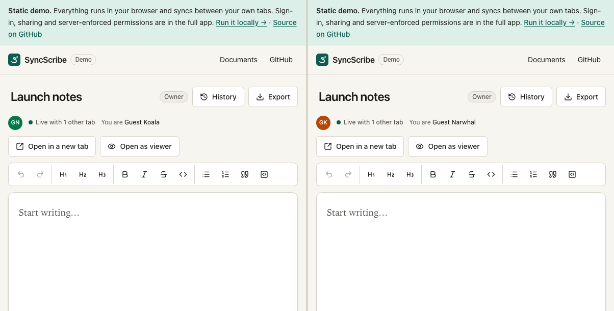
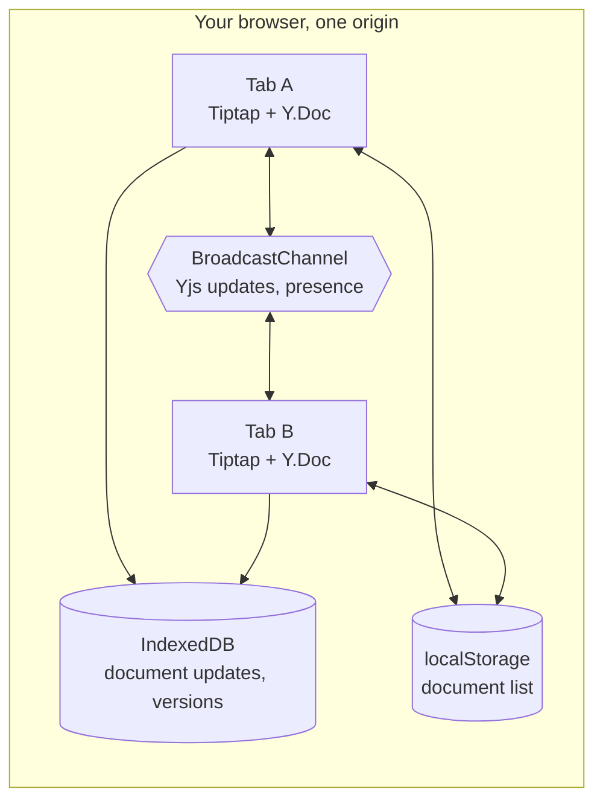
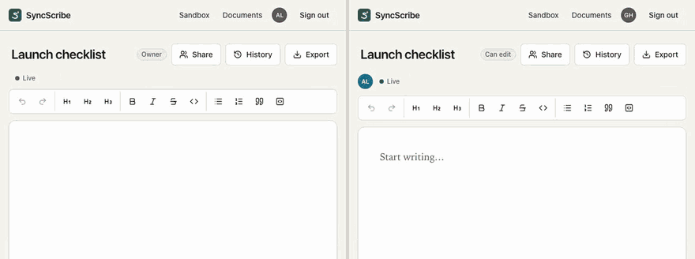
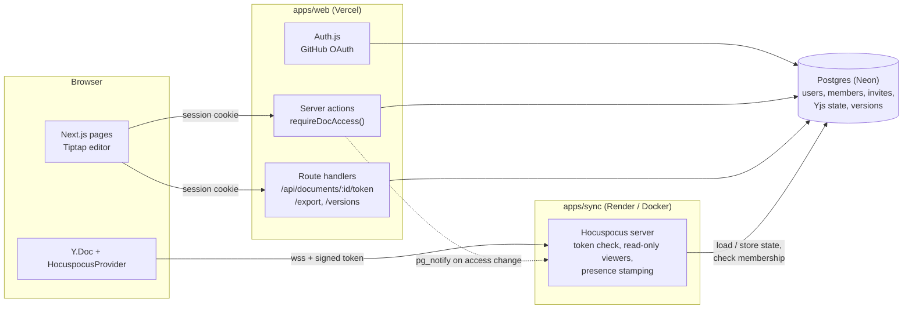
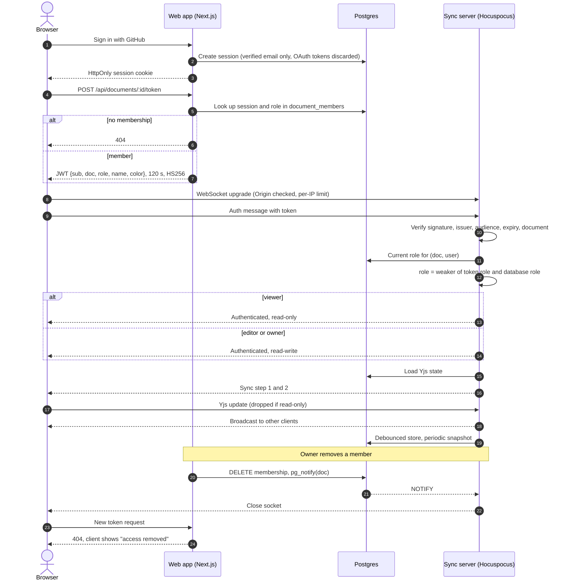

# SyncScribe

A real-time collaborative document editor with role-based sharing, version history and a self-hosted Yjs sync server.

**Live demo: [shashank11yadav.github.io/SyncScribe](https://shashank11yadav.github.io/SyncScribe/)**. This is the in-browser demo: it runs entirely in your browser and syncs between your own tabs, with no server behind it.

Write-up and other projects: [shashankyadav.dev/work/syncscribe](https://www.shashankyadav.dev/work/syncscribe)



*Two tabs of the GitHub Pages build editing the same document. Captured from the production build with `apps/demo/e2e/readme-media.spec.ts`.*

[](https://github.com/shashank11yadav/SyncScribe/actions/workflows/ci.yml)
[](https://github.com/shashank11yadav/SyncScribe/actions/workflows/codeql.yml)
[](https://github.com/shashank11yadav/SyncScribe/actions/workflows/pages.yml)

## The live demo and the full app

GitHub Pages serves static files only, so the live demo cannot run the database, the sign-in flow or the sync server. It reuses the same editor, toolbar, presence, Markdown serializer and role rules as the full app, and swaps the server for browser APIs.

| | Live demo (GitHub Pages) | Full app (run it yourself) |
| --- | --- | --- |
| Co-editing | Between tabs of one browser, over a BroadcastChannel | Between any browsers, through the Hocuspocus sync server |
| Presence and named cursors | A guest name per tab | GitHub name, stamped by the sync server |
| Where documents live | IndexedDB in your browser | Postgres |
| Version history, preview, restore | Yes, stored in your browser | Yes, stored in Postgres |
| Markdown export | Yes, same serializer | Yes |
| Sign-in | None | GitHub OAuth through Auth.js |
| Sharing by email, invites | No | Yes |
| Owner, editor and viewer roles | An "Open as viewer" tab that previews the read-only UI | Enforced on every request and on the websocket |
| Live revocation | No | Yes |
| Guest sandbox | Not needed: every document is local | `/sandbox`, shared by everyone, reset every 30 minutes |

To try the full app, see [Run the full app locally](#run-the-full-app-locally).

### How the live demo works



- Each tab holds a full `Y.Doc`. A small provider (`apps/demo/src/lib/broadcast-provider.ts`) posts every local Yjs update and awareness change on a BroadcastChannel named after the document. A tab that opens late sends its state vector and gets back exactly what it is missing.
- `y-indexeddb` stores the updates, so documents survive a reload. Versions are full Yjs snapshots in a separate IndexedDB store. Restoring one writes the old content into the live document as a new edit, as the full app does, and saves the current text first.
- The document list lives in `localStorage`, and other tabs pick up renames from the `storage` event. A tab that has a deleted document open hears about it on a second channel and closes it before the database is removed.
- The page only requests its own static files, and document content never leaves the browser. There is no signaling server, analytics or CDN. The production build carries a Content-Security-Policy with `connect-src 'self'`, and the e2e suite fails on any request to another host.

## The full app



*Two browsers signed in as different users, typing into the same document at the same time. Recorded with `apps/web/e2e/readme-media.spec.ts`.*

### Features

- **Live co-editing.** Yjs merges concurrent edits character by character. Remote cursors show each person's name, and a presence list shows who is in the document.
- **Owner, editor and viewer roles.** Checked on every server action and route handler, and again by the sync server, which gives viewers a read-only socket.
- **Sharing by email.** Works the same whether or not the address has an account yet, so the share dialog cannot be used to find out who has signed up.
- **Live revocation.** Removing someone or lowering their role closes their socket within a second; their next connection gets the new permissions.
- **Version history.** Snapshots are taken while people write. Any version can be previewed and restored, and a restore never destroys the text it replaces.
- **Markdown export** from a serializer written for this project and covered by tests.
- **Guest sandbox.** `/sandbox` is a public document anyone can edit without signing in. It is isolated from real documents and resets every 30 minutes.
- **GitHub sign-in** through Auth.js, with database sessions.
- Keyboard-navigable toolbar, native `<dialog>` modals, visible focus, dark mode, reduced-motion support, and a layout that works at 375px. Axe checks run in the e2e suite.

## Architecture



The web app owns identity and permissions. The sync server owns the live documents. They share a Postgres database and a signing secret, and nothing else. `packages/shared` holds the role rules, zod schemas and token format so the two apps cannot drift apart.

### From sign-in to a synced keystroke



## Authorization model

One table drives every check. It lives in [`packages/shared/src/roles.ts`](packages/shared/src/roles.ts) and is pinned by a hand-written copy in the tests.

| Action | Viewer | Editor | Owner |
| --- | :---: | :---: | :---: |
| Open and read, see collaborators, export Markdown | yes | yes | yes |
| Leave the document | yes | yes | no (transfer first) |
| Edit content | no | yes | yes |
| Rename | no | yes | yes |
| Invite people as viewer or editor | no | yes | yes |
| See pending invites | no | yes | yes |
| View, save and restore versions | no | yes | yes |
| Change a member's role | no | no | yes |
| Remove other members, revoke invites | no | no | yes |
| Transfer ownership (to an existing member) | no | no | yes |
| Delete the document | no | no | yes |

Rules that every check follows:

- The caller's identity comes from the server-side session and their role from `document_members`. Request bodies are parsed with strict zod schemas, so an extra `role` or `userId` field fails validation.
- People without access get "not found", never "forbidden", so document ids cannot be probed.
- Nobody can grant `owner` through sharing. Ownership only moves by transfer, inside a transaction, and Postgres has a partial unique index that allows one owner per document.
- The sync server enforces the edit permission itself. A modified client that ignores the read-only flag still has its updates discarded.

## Design decisions and trade-offs

**Yjs (a CRDT) instead of operational transforms or last-write-wins.** Yjs merges edits without a central sequencer, so the sync server only relays and persists updates. Clients keep working through brief disconnects and merge cleanly afterwards. The cost is that you cannot "delete" content on the server: a client still holding old state would merge it back. That shaped two features. Restoring a version writes the old content as a new edit, and resetting the sandbox runs a normal Yjs transaction instead of wiping storage.

**A self-hosted Hocuspocus server instead of a hosted realtime service.** The previous version of this project used a hosted service whose permission model lived in someone else's dashboard. Running the sync server makes the security boundary visible and testable: the websocket tests in `apps/sync/test` connect real providers and assert that bad tokens, strangers and viewer writes are rejected. It also keeps documents in my own Postgres, next to the membership data the permission checks read.

**Short-lived signed tokens instead of sharing the session cookie.** The sync server runs on a different origin and should not parse Auth.js sessions. The web app mints a two-minute token for one user, one document and one role. The sync server still checks the database, because a token can outlive a permission change by up to two minutes.

**Postgres LISTEN/NOTIFY for revocation.** It avoids adding Redis or a message queue. The catch on Neon is that LISTEN needs the direct (unpooled) connection string, and a held connection keeps the compute awake while the sync server is running.

**Sharing always creates an invite.** Converting the invite to a membership happens when the recipient next loads the app. This costs one extra query on page load and means a registered user does not see a shared document until they refresh, but it removes the user-enumeration side channel completely.

**Server actions return results instead of throwing.** A small `runAction` wrapper maps access errors, validation errors and rate limits to safe messages, and keeps `redirect()` outside any `try`, which was a bug in the old code.

**Rate limits in Postgres.** A single atomic upsert per request works across serverless instances without another service. It is not as fast as Redis, which is fine at this scale.

**Auth.js v5.** It is still published under the `beta` tag, but it is the version with first-class App Router support, the Drizzle adapter and the `auth()` helper used throughout. The adapter is wrapped so GitHub access tokens are never stored.

**TypeScript 6, not 7.** TypeScript 7 (the Go port) is out, but `typescript-eslint` does not support it yet, so the repo stays on 6.0.

**A static demo next to the full app, instead of a hosted full stack.** Keeping the full app online for free means a database, a sync server and a web host on free tiers that sleep when idle, so visitors would often meet a cold start. The Pages demo is always up and shows the editing experience, while the parts that need a server (identity, sharing, enforced roles) stay in the full app that anyone can run with Docker. The demo shares the editor package, role table and Markdown serializer, so it is not a separate implementation.

**BroadcastChannel instead of y-webrtc for the demo.** y-webrtc would let two different browsers edit together, but only through public signaling servers run by someone else, which a static demo cannot vouch for. BroadcastChannel keeps everything inside one browser and makes no network requests at all. The trade-off is that the demo cannot show two people on two machines.

## Security

The short version: browser input is untrusted, identity comes only from the session, roles come only from the database, the sync server verifies everything itself, and the edit permission is enforced server-side on the websocket. See [SECURITY.md](SECURITY.md) for the threat model.

Other measures:

- Nonce-based CSP (`strict-dynamic`), `frame-ancestors 'none'`, HSTS, `nosniff`, a strict referrer policy and a locked-down `Permissions-Policy`.
- Origin checks on websocket upgrades and on token-minting routes.
- Only verified GitHub emails are stored, because invites are matched by email.
- `npm audit --omit=dev` runs in CI and must report no high or critical issues. CodeQL runs on every push and weekly. Dependabot watches npm, GitHub Actions and the sync server's base image. Actions are pinned to commit SHAs and the CI token is read-only.

### The live demo

The demo has no accounts or server, so most of the threat model above does not apply. What it does defend against:

- **Other pages on the same origin.** All of a GitHub user's project sites share the `shashank11yadav.github.io` origin, and with it localStorage, IndexedDB and BroadcastChannel. Every key and channel is prefixed `syncscribe-demo:`, and everything read back is validated: the document list and stored versions with zod, BroadcastChannel messages against the exact shapes the demo sends, and remote presence (name, colour, cursor) before it reaches the editor. Corrupt Yjs bytes are dropped instead of applied.
- **Script injection.** The build adds a CSP meta tag: `default-src 'self'`, `script-src 'self'`, `style-src 'self'`, `connect-src 'self'`, `object-src 'none'`, `base-uri 'self'`, `form-action 'none'`, with no `unsafe-inline` or `unsafe-eval` anywhere. Remote cursors are coloured through the CSSOM, which CSP does not restrict, and zod runs in its no-eval mode. `frame-ancestors` cannot be set from a meta tag and GitHub Pages does not allow custom headers, so the demo can be framed; it holds no credentials, so there is nothing to clickjack.
- **Storage failures.** Every storage call is wrapped. A private window that blocks storage still works for the session and says so in the banner.

The "Open as viewer" tab is a UI preview. A modified client could still write from it, because there is no server to refuse the update. In the full app the sync server opens viewer connections read-only and discards their writes.

## Run it locally

Requirements: Node 24 (22.12 or newer works) and npm 10 or newer. The full app also needs Docker.

```bash
git clone https://github.com/shashank11yadav/SyncScribe.git
cd SyncScribe
npm ci
```

### Run the live demo locally

No database, accounts or `.env` needed.

```bash
npm run dev -w @syncscribe/demo
```

Open http://localhost:5210/SyncScribe/ and use "Open in a new tab" to get a second tab. To check the production build, which is what GitHub Pages serves and the only build with the CSP applied:

```bash
npm run build -w @syncscribe/demo
npm run preview -w @syncscribe/demo   # http://localhost:5211/SyncScribe/
```

### Run the full app locally

1. **Create `.env`** from the example. Every app in the workspace reads this one file, and Docker Compose reads it too, so create it before starting any container.

   ```bash
   cp .env.example .env
   ```

2. **Generate two secrets** and paste them into `.env`. Run the command twice; the values must differ.

   ```bash
   openssl rand -base64 32   # AUTH_SECRET
   openssl rand -base64 32   # SYNC_TOKEN_SECRET
   ```

3. **Create a GitHub OAuth app** for local sign-in: GitHub, Settings, Developer settings, OAuth Apps, New OAuth App.
   - Homepage URL: `http://localhost:5200`
   - Authorization callback URL: `http://localhost:5200/api/auth/callback/github`

   Copy the client ID into `AUTH_GITHUB_ID`, generate a client secret and copy it into `AUTH_GITHUB_SECRET`. If you only want the guest sandbox for now, any placeholder text works; sign-in starts working once the values are real.

4. **Start Postgres.** It listens on port 5433 so it does not collide with a Postgres you may already run on 5432.

   ```bash
   docker compose up -d db
   ```

5. **Run the migrations and start both servers.**

   ```bash
   npm run db:migrate
   npm run dev
   ```

| URL | What |
| --- | --- |
| http://localhost:5200 | Web app. Sign in with GitHub, then create and share documents. |
| http://localhost:5200/sandbox | Guest sandbox, no sign-in needed. |
| ws://localhost:5201 | Sync server (health check at http://localhost:5201/healthz). |

To try roles, sign in with a second GitHub account in another browser profile and share a document with its email address.

If you would rather not run the sync server on the host, compose can run Postgres, the migrations and the sync server, and you start only the web app:

```bash
docker compose up -d        # db, migrate, and sync on :5201
npm run dev -w @syncscribe/web
```

Stop everything with `docker compose down` (add `-v` to delete the database volume as well).

## Testing

```bash
npm run lint
npm run typecheck
npm test          # unit + integration (needs the compose Postgres; creates syncscribe_test)
npm run e2e       # full app Playwright suite; starts the dev servers if they are not running
npm run e2e -w @syncscribe/demo   # builds the demo, then runs its Playwright suite against vite preview
```

What is covered:

- `packages/shared`: every cell of the permission matrix (viewer, editor, owner and stranger for each action), the relational rules, input schemas, token signing and verification (expired, wrong secret, wrong audience, wrong document, tampered payload, `alg: none`, guest scope), the Markdown serializer and the sandbox seed.
- `packages/editor`: validation of remote presence before it is shown.
- `apps/web`: every server action and route handler against a real Postgres, with only the session faked. Negative cases include viewers trying to edit, share and delete, strangers trying to read, forged roles in request bodies, cross-origin token requests, identical share responses for registered and unknown emails, cross-document invite and version access, and rate limits.
- `apps/sync`: real Hocuspocus providers over real websockets. Invalid, expired, foreign-document and wrong-secret tokens are refused; strangers are refused; viewer writes are dropped and never persisted; a token claiming more than the database grants is downgraded; removed members are disconnected and refused on reconnect; downgraded members come back read-only; spoofed presence is overwritten; unknown origins and connection floods are refused.
- `apps/web/e2e`: two browser contexts co-editing and seeing each other's presence, viewer read-only mode, a stranger getting a 404, live revocation, sharing, export, version restore, the guest sandbox, axe accessibility checks and a 375px layout check. E2E sign-in seeds a database session instead of going through GitHub; everything after the cookie is the real Auth.js session lookup.
- `apps/demo/test`: the BroadcastChannel provider between real channels (live edits, late joiners, concurrent offline edits, presence arriving and leaving, no echo, malformed and corrupt messages), message and presence validation, the document list against bad and hostile storage contents, version history in IndexedDB (ordering, the per-document cap, unchanged content, records that fail validation), and persistence through `y-indexeddb`.
- `apps/demo/e2e`: runs against the production build. Two pages in one browser context co-edit and see each other's presence, edits survive a reload, export produces the expected Markdown, a version restore reaches the other tab, the viewer tab cannot type, renames and deletes reach other tabs, axe finds no serious issues, and the layout fits 375px. Every test fails on a console error, a CSP violation or a request to another host.

To regenerate the GIFs at the top of this file:

```bash
# live demo
cd apps/demo
npm run build
CAPTURE_MEDIA=1 npx playwright test readme-media
./scripts/readme-gif.sh                # writes docs/live-demo.gif

# full app (with the app running)
cd apps/web
CAPTURE_MEDIA=1 npx playwright test readme-media
# stitch test-results/readme-media/{left,right}/*.webm side by side with ffmpeg hstack + palettegen
```

## Deployment

### The live demo

`.github/workflows/pages.yml` builds `apps/demo` and publishes it to GitHub Pages on every push to `master`, or when run by hand. It needs Pages enabled with "GitHub Actions" as the source (repository Settings, Pages).

### The full app (optional)

Everything below fits in free tiers as of October 2026. Check each provider's current terms before relying on them. Free instances sleep when idle, so expect a slow first load.

#### 1. Postgres on Neon

1. Create a project at [neon.com](https://neon.com). The free plan gives 0.5 GB storage and 100 compute-hours per month, and scales to zero after five idle minutes.
2. Copy two connection strings: the **pooled** one (host contains `-pooler`) for the web app, and the **direct** one for the sync server and migrations. LISTEN/NOTIFY does not work through the pooler.
3. Run migrations from your machine: `DATABASE_URL="<direct url>" npm run db:migrate`.

#### 2. GitHub OAuth app

1. GitHub, Settings, Developer settings, OAuth Apps, New OAuth App.
2. Homepage URL: your Vercel URL. Authorization callback URL: `https://<your-vercel-domain>/api/auth/callback/github`.
3. Generate a client secret. Use the client id and secret as `AUTH_GITHUB_ID` and `AUTH_GITHUB_SECRET`.
4. For local development, create a second OAuth app with the localhost callback. GitHub allows one callback URL per app.

#### 3. Sync server on Render

Render's free web services support WebSockets. They sleep after 15 minutes without traffic and take about a minute to wake on the next connection, so the first visitor after a quiet period will see "Connecting" for a while. Koyeb's free instance is an alternative with a one-hour idle timeout. Fly.io no longer has a free allowance for new accounts.

1. New Web Service from this repository, runtime **Docker**, Dockerfile path `apps/sync/Dockerfile`, Docker context `.` (repository root).
2. Environment variables:
   - `DATABASE_URL`: the Neon **direct** URL
   - `SYNC_TOKEN_SECRET`: same value as the web app
   - `ALLOWED_ORIGINS`: `https://<your-vercel-domain>`
   - `TRUST_PROXY`: `true` (Render sits in front of the container)
3. Health check path: `/healthz`.
4. Note the service URL and use `wss://<service>.onrender.com` as `NEXT_PUBLIC_SYNC_URL` below.

#### 4. Web app on Vercel

1. Import the repository. Set **Root Directory** to `apps/web`. Vercel detects the npm workspace and installs from the root.
2. Environment variables:
   - `DATABASE_URL`: the Neon **pooled** URL
   - `AUTH_SECRET`, `AUTH_GITHUB_ID`, `AUTH_GITHUB_SECRET`
   - `SYNC_TOKEN_SECRET`: same value as the sync server
   - `NEXT_PUBLIC_SYNC_URL`: `wss://<service>.onrender.com`
3. Deploy, then update the GitHub OAuth app's callback URL if the domain changed.

If you are replacing an older deployment of this repository, remove its old environment variables (Clerk, Liveblocks, Sentry) from the Vercel project before deploying.

## Project structure

```
.
├── apps
│   ├── web                     Next.js 16 app (App Router)
│   │   ├── src/app             pages and route handlers
│   │   ├── src/components      Hocuspocus wiring, share and history dialogs
│   │   ├── src/server          access checks, server actions, queries, rate limits
│   │   ├── src/auth.ts         Auth.js config (GitHub, database sessions)
│   │   ├── src/proxy.ts        CSP nonce and headers only
│   │   ├── test                integration tests for actions and routes
│   │   └── e2e                 Playwright specs
│   ├── sync                    Hocuspocus server
│   │   ├── src/auth.ts         token + membership check
│   │   ├── src/server.ts       hooks: upgrade, auth, load/store, presence, LISTEN
│   │   ├── src/throttle.ts     per-address upgrade limit
│   │   ├── test                websocket auth and persistence tests
│   │   └── Dockerfile
│   └── demo                    static GitHub Pages demo (Vite + React)
│       ├── src/lib             BroadcastChannel provider, IndexedDB history, validation
│       ├── src/components      document list, editor page, history dialog
│       ├── test                unit tests (Vitest, fake-indexeddb)
│       └── e2e                 Playwright specs against the production build
├── packages
│   ├── editor                  editor surface, toolbar, presence, dialogs, styles
│   ├── shared                  roles, zod schemas, token format, Markdown, seed content
│   └── db                      Drizzle schema, migrations, client
├── test                        shared test setup (database creation, factories)
├── docker-compose.yml          Postgres on 5433, migrations, sync server
└── .github                     CI, CodeQL, Pages, Dependabot
```

## Limitations and next steps

- **One sync instance.** Hocuspocus keeps each document in one process. Scaling out needs `@hocuspocus/extension-redis` and sticky routing.
- **Cold starts on free hosting.** The Render free tier sleeps; the first connection after a quiet period is slow.
- **Shared HMAC secret.** Both apps hold `SYNC_TOKEN_SECRET`. Moving to Ed25519 would let the sync server verify tokens without being able to mint them.
- **No offline persistence in the full app yet.** The demo already uses `y-indexeddb`; the full app could do the same so a page reloads offline without losing unsynced edits.
- **No comments or suggestions mode.**
- **Invites are claimed on the next page load,** not pushed to an already-open session.
- **Exports reflect stored state,** which trails live typing by up to a couple of seconds.
- **Sign-in is GitHub only,** and invites match on the account's verified email. Someone whose GitHub account has no verified email can sign in but cannot receive invites.
- **The live demo only syncs within one browser.** Two people on two machines need the full app. Its documents also stay in the browser that made them, and clearing site data deletes them.
- **The demo can lose the last keystrokes before a tab closes** if no other tab has the document open, because `y-indexeddb` writes each update in its own transaction.

## Credits

Built on these open-source projects:

- [Yjs](https://github.com/yjs/yjs) by Kevin Jahns, the CRDT that does the merging (MIT)
- [Hocuspocus](https://github.com/ueberdosis/hocuspocus) and [Tiptap](https://github.com/ueberdosis/tiptap) by überdosis, the websocket backend and editor (MIT)
- [ProseMirror](https://prosemirror.net) by Marijn Haverbeke, underneath Tiptap (MIT)
- [Next.js](https://github.com/vercel/next.js) and [React](https://github.com/facebook/react) (MIT)
- [Auth.js](https://github.com/nextauthjs/next-auth) (ISC)
- [Drizzle ORM](https://github.com/drizzle-team/drizzle-orm) (Apache-2.0) and [postgres.js](https://github.com/porsager/postgres) (Unlicense)
- [zod](https://github.com/colinhacks/zod) (MIT) and [jose](https://github.com/panva/jose) (MIT)
- [Tailwind CSS](https://github.com/tailwindlabs/tailwindcss) (MIT) and [Lucide](https://github.com/lucide-icons/lucide) icons (ISC)
- [Vite](https://github.com/vitejs/vite) (MIT) and [y-indexeddb](https://github.com/yjs/y-indexeddb) by Kevin Jahns (MIT), for the static demo
- [Vitest](https://github.com/vitest-dev/vitest), [Playwright](https://github.com/microsoft/playwright) and [axe-core](https://github.com/dequelabs/axe-core) (MPL-2.0) for testing

The first version of this repository followed the JavaScript Mastery "LiveDocs" tutorial ([adrianhajdin/collaborative-editor](https://github.com/adrianhajdin/collaborative-editor)). This version is a rewrite with a different architecture; none of that code remains.

## License

[MIT](LICENSE) © 2026 Shashank Yadav
